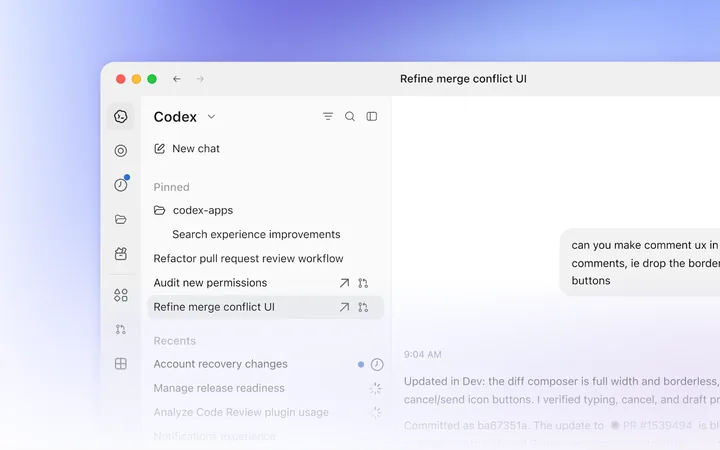
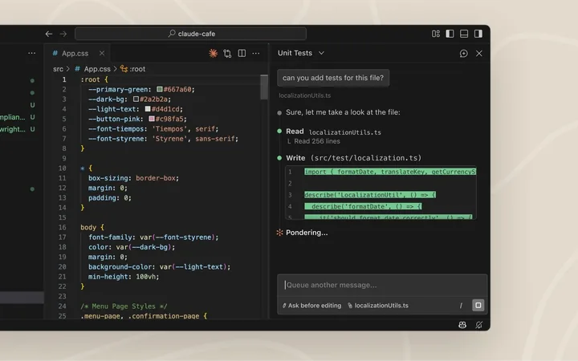
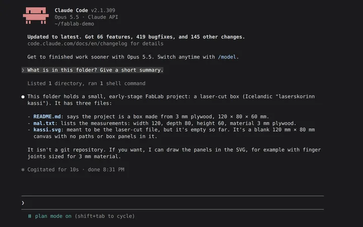
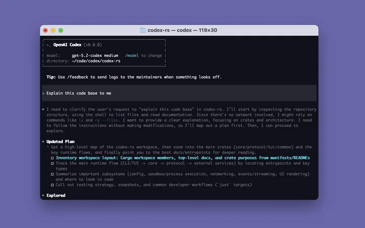
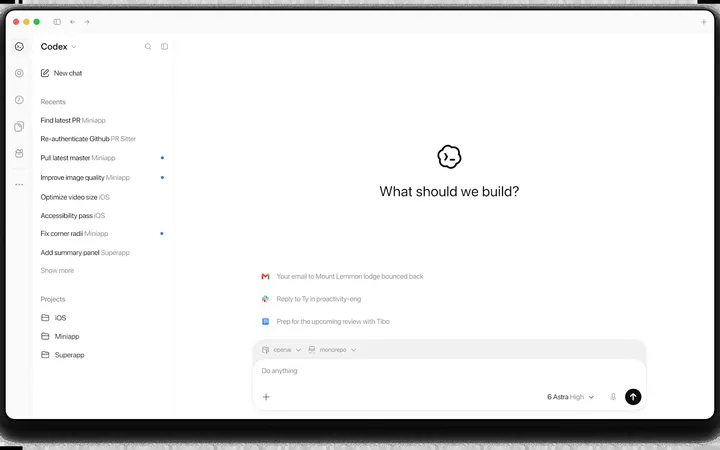
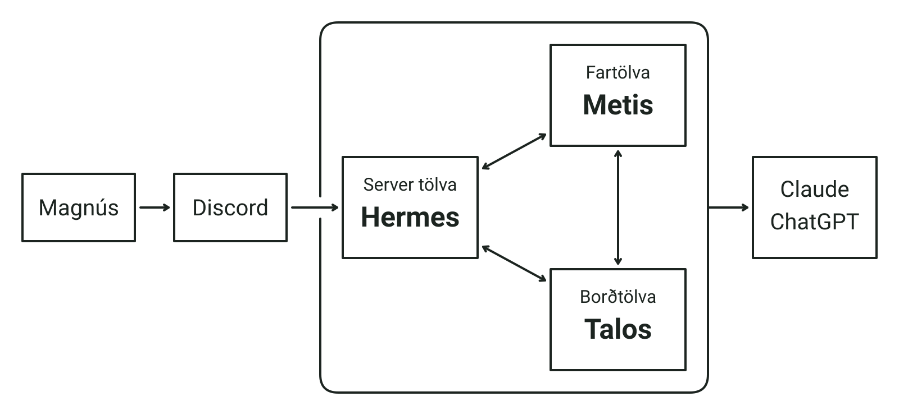
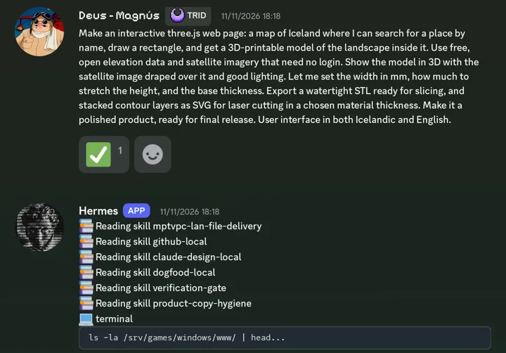
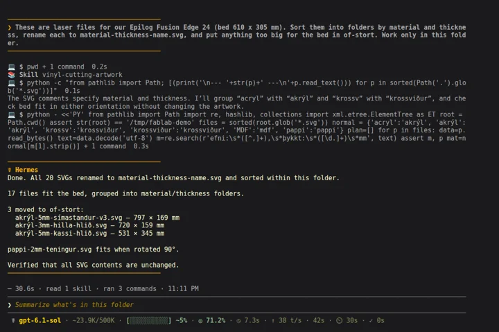

<header class="mp-faq-head" markdown>

# Gervigreind og agentar

<p class="mp-faq-meta">Fab Lab Ísland · 18. nóvember 2026</p>

</header>

<nav class="mp-faq-toc" aria-label="Spurningar">
<ol>
<li><a href="#hvad-er-agent">Hvað er agent?</a></li>
<li><a href="#chat-agent-myndgerd">Chat, agent og myndgerð</a></li>
<li><a href="#hvad-getur-agent-gert">Hvað getur agent gert?</a></li>
<li><a href="#tengingar-mcp">Tengingar (MCP)</a></li>
<li><a href="#oryggi-og-gogn">Öryggi og gögn</a></li>
<li><a href="#sandbox-og-docker">Sandbox og Docker</a></li>
<li><a href="#hvernig-vinnur-madur-med-agent">Hvernig vinnur maður með agent?</a></li>
<li><a href="#hvad-er-i-bodi">Hvað er í boði?</a></li>
<li><a href="#ekki-alltaf-eins">Gervigreind og gervigreind eru ekki alltaf eins</a></li>
<li><a href="#hvar-byrja-eg">Hvar byrja ég og hvað kostar það?</a></li>
<li><a href="#gott-prompt">Hvernig skrifa ég gott prompt?</a></li>
<li><a href="#bara-ad-bulla">Hvernig veit ég hvort hann sé bara að bulla?</a></li>
</ol>
</nav>

<section class="mp-q" markdown>

## Hvað er agent? {#hvad-er-agent}

Gervigreind sem getur framkvæmt, ekki bara svarað. Hún fær tól (skrár, skipanir, vafra), tekur skref, skoðar útkomuna og ákveður næsta skref.

</section>

<section class="mp-q" markdown>

## Chat, agent og myndgerð {#chat-agent-myndgerd}

<dl class="mp-pair mp-pair--three">
<div><dt>Chat</dt><dd>Svarar og skrifar texta. Þið vinnið verkið sjálf.</dd></div>
<div><dt>Agent</dt><dd>Vinnur verkið. Les og breytir skrám, keyrir skipanir og prófar útkomuna.</dd></div>
<div><dt>Myndgerð</dt><dd>Býr til myndir. Hugsar hvorki né framkvæmir.</dd></div>
</dl>

</section>

<section class="mp-q" markdown>

## Hvað getur agent gert? {#hvad-getur-agent-gert}

- Lesið og breytt skrám, keyrt skipanir, byggt og prófað hluti.
- Unnið sjálfstætt að markmiði í mörgum skrefum.

<p class="mp-note">Hann vinnur með þeim aðgangi sem þið gefið honum. Ef hann skýtur upp á bak getur það verið fjörugt. <strong>Passið að takmarka aðgengi.</strong></p>

</section>

<section class="mp-q" markdown>

## Tengingar (MCP) {#tengingar-mcp}

MCP er staðall sem leyfir agent-um að tala við annan hugbúnað. Til dæmis Google Workspace (póstur, Drive, dagatal), Notion eða gagnagrunna. Svipað og USB fyrir gervigreind.

<p class="mp-note">Tengið bara það sem verkefnið þarf. <strong>Alltaf best að byrja read-only.</strong></p>

<p class="mp-aside">(Ég hef aldrei treyst gervigreind fyrir samskiptum)</p>

</section>

<section class="mp-q" markdown>

## Öryggi og gögn {#oryggi-og-gogn}

Byrjið í afmörkuðu umhverfi: ein mappa, engar persónuupplýsingar, engin admin réttindi.

<dl class="mp-terms">
<div><dt>Permission modes</dt><dd>Agentinn spyr áður en hann framkvæmir (Claude Code: Manual eða Plan. Codex: Approval). Aldrei byrja í "skip permissions".</dd></div>
<div><dt>Prompt injection</dt><dd>Tölvupóstur eða vefsíða getur haft faldar skipanir sem agentinn hlýðir. Þess vegna skiptir máli hvað þið tengið hann við.</dd></div>
<div><dt>Þjálfun</dt><dd>ChatGPT og Gemini á persónulegum áskriftum þjálfa á gögnunum ykkar nema þið slökkvið á því. Claude spyr. Vinnu- og skólaáskriftir þjálfa ekki.</dd></div>
</dl>

</section>

<section class="mp-q" markdown>

## Sandbox og Docker {#sandbox-og-docker}

Því meiri einangrun, því meira frelsi má gefa agentinum.

<dl class="mp-terms">
<div><dt>Sandbox</dt><dd>Agentinn kemst bara í eina möppu og fer ekki á netið nema þið leyfið það. Codex gerir þetta sjálfgefið. Í Claude Code kveikið þið á því með /sandbox.</dd></div>
<div><dt>Sér notandi eða virtual machine</dt><dd>Agentinn fær sinn eigin aðgang að tölvunni, án ykkar skjala og innskráninga.</dd></div>
<div><dt>Docker</dt><dd>Agentinn keyrir í container sem er einangraður frá restinni af tölvunni. Þá má leyfa honum meira án þess að hann snerti annað. VS Code Dev Containers einfalda þetta. Á Windows og Mac þarf Docker Desktop.</dd></div>
</dl>

</section>

<section class="mp-q" markdown>

## Hvernig vinnur maður með agent? {#hvernig-vinnur-madur-med-agent}

<table class="mp-table mp-table--ways">
<thead><tr><th scope="col">Leið</th><th scope="col">Dæmi</th><th scope="col">Athugasemd</th></tr></thead>
<tbody>
<tr><th scope="row">Forrit</th><td>Claude Desktop (með Claude Code) eða Codex appið.<figure class="mp-shot"><a href="images/faq/forrit-codex-app.webp"></a><figcaption>Mynd: OpenAI</figcaption></figure></td><td>Auðveldasta byrjunin.</td></tr>
<tr><th scope="row">Í IDE</th><td>VS Code með Claude Code eða Codex viðbót, Cursor, Google Antigravity.<figure class="mp-shot"><a href="images/faq/ide-vscode-claude-code.webp"></a><figcaption>Mynd: Anthropic</figcaption></figure></td><td></td></tr>
<tr><th scope="row">Í terminal (CLI)</th><td>Claude Code, Codex CLI.<figure class="mp-shot"><a href="images/faq/terminal-claude-code.webp"></a></figure><figure class="mp-shot"><a href="images/faq/terminal-codex-cli.webp"></a><figcaption>Mynd: OpenAI</figcaption></figure></td><td>Öflugast en tæknilegast.</td></tr>
<tr><th scope="row">Í skýinu</th><td>Codex cloud, Claude Code á vefnum.<figure class="mp-shot"><a href="images/faq/sky-codex-cloud.webp"></a><figcaption>Mynd: OpenAI</figcaption></figure></td><td>Vinnur á afriti hjá þeim, ekki á tölvunni ykkar.</td></tr>
<tr><th scope="row">Í gegnum spjallforrit</th><td>Hermes á t.d. Discord<figure class="mp-shot mp-shot--diagram"><a href="images/agent-uppsetning.svg"><picture><source media="(max-width: 37.5em)" srcset="images/agent-uppsetning-lodrett.svg" width="900" height="1470"></picture></a></figure><figure class="mp-shot"><a href="images/faq/discord-hermes.webp"></a></figure><figure class="mp-shot"><a href="images/faq/terminal-hermes.webp"></a></figure></td><td>(Ég nota þetta mikið)</td></tr>
</tbody>
</table>


</section>

<section class="mp-q" markdown>

## Hvað er í boði? {#hvad-er-i-bodi}

<table class="mp-table mp-table--tools">
<thead><tr><th scope="col">Agent</th><th scope="col">Styrkleikar og veikleikar</th></tr></thead>
<tbody>
<tr><th scope="row"><a href="https://claude.com/product/claude-code">Claude Code</a> <span class="mp-vendor">(Anthropic)</span></th><td>Sterkt í kóða og löngum, vönduðum verkefnum. Góð stjórn á heimildum.</td></tr>
<tr><th scope="row"><a href="https://openai.com/codex/">Codex</a> <span class="mp-vendor">(OpenAI)</span></th><td>Innifalið í ChatGPT Plus. Keyrir í sandbox sjálfgefið. Þægilegra viðmót en ekki jafn góður forritari.</td></tr>
<tr><th scope="row">Gemini / <a href="https://antigravity.google/">Antigravity</a> <span class="mp-vendor">(Google)</span></th><td>Stórt context og ódýr byrjun. Ekki jafn fínpússuð upplifun.</td></tr>
<tr><th scope="row"><a href="https://github.com/features/copilot">GitHub Copilot</a></th><td>Fyrir forritara inni í IDE. Ekki það sama og Microsoft Copilot.</td></tr>
<tr><th scope="row"><a href="https://github.com/NousResearch/hermes-agent">Hermes</a> og annað open source</th><td>Full stjórn og hvaða módel sem er. Þið keyrið þetta sjálf. Bleeding edge.</td></tr>
<tr><th scope="row">Local módel <span class="mp-vendor">(<a href="https://ollama.com">Ollama</a>, <a href="https://lmstudio.ai">LM Studio</a>)</span></th><td>Gögnin fara aldrei af tölvunni. Ókeypis en töluvert slakari.</td></tr>
</tbody>
</table>

</section>

<section class="mp-q" markdown>

## Gervigreind og gervigreind eru ekki alltaf eins {#ekki-alltaf-eins}

Hver framleiðandi býður upp á nokkur módel. Skiptast sirka í tvennt: Stór, hæg og dýr. Lítil, hröð og ódýr.

<dl class="mp-terms">
<div><dt>Dæmi</dt><dd>Claude Opus, Sonnet og Haiku.<br>Gemini Pro og Flash.<br>GPT Astra, Sol, Terra og Luna.</dd></div>
<div><dt>"Thinking"</dt><dd>Mörg módel geta hugsað lengur áður en þau svara. Betra í flókin verkefni.</dd></div>
</dl>

Ókeypis áskriftir fá oftast minni og mikið takmarkaðri módel.

Fyrir agent-a skiptir þetta miklu máli. Lítið módel á frekar til að mistakast eða jafnvel gefast upp í lengri verkefnum.

</section>

<section class="mp-q" markdown>

## Hvar byrja ég og hvað kostar það? {#hvar-byrja-eg}

- Ef þið eruð með ChatGPT Plus ($20, ≈3.050&nbsp;kr) er Codex innifalið. **Prófið það fyrst.**
- Annars Claude Pro ($20, ≈3.050&nbsp;kr) með Claude Code í Desktop appinu.
- Byrjið á einu ódýru og færið ykkur upp ef þið rekist á usage limit.

</section>

<section class="mp-q" markdown>

## Hvernig skrifa ég gott prompt? {#gott-prompt}

- Skrifið á ensku. Agentar eru því miður talsvert slakari á íslensku.
- Lýsið útkomunni eins og þið viljið hafa hana, ekki bara ferlinu.
- Gefið agentinum þær upplýsingar sem hann þarf til að klára verkið.
- Segið hvenær verkið telst klárt og hvað þarf ykkar samþykki.

<p class="mp-prompt-label">Dæmi (promptið sem bjó til Landlíkan, <a href="https://magnusp.is/landlikan/">https://magnusp.is/landlikan/</a>):</p>

``` { .text .mp-prompt }
Make an interactive three.js web page: a map of Iceland where I can search for a place by name, draw a rectangle, and get a 3D-printable model of the landscape inside it. Use free, open elevation data and satellite imagery that need no login. Show the model in 3D with the satellite image draped over it and good lighting. Let me set the width in mm, how much to stretch the height, and the base thickness. Export a watertight STL ready for slicing, and stacked contour layers as SVG for laser cutting in a chosen material thickness. Make it a polished product, ready for final release. User interface in both Icelandic and English.
Publish it and put it on pages.
```

</section>

<section class="mp-q" markdown>

## Hvernig veit ég hvort hann sé bara að bulla? {#bara-ad-bulla}

- Látið hann prófa eigin vinnu og opnið svo útkomuna sjálf.
- Biðjið um heimildir og athugið hvort þær segi það sem hann heldur fram.
- Notið alltaf Git/version control.
- Litlar prufur fyrst. Vel heppnað export er ekki það sama og vel heppnuð prentun.

</section>
